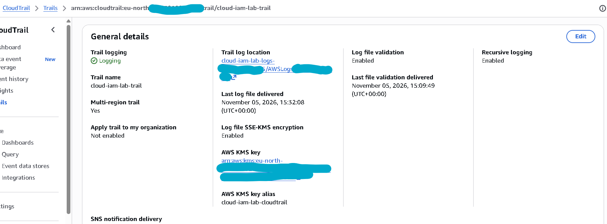
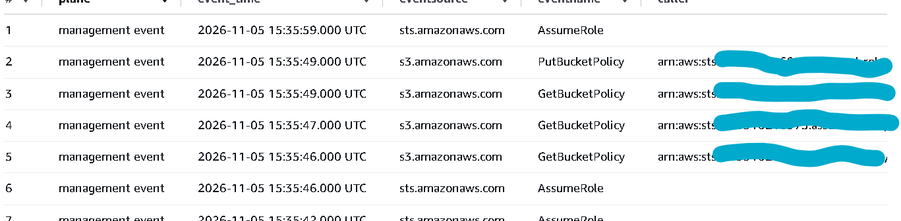
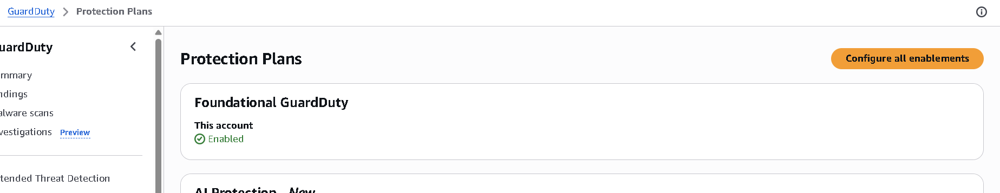
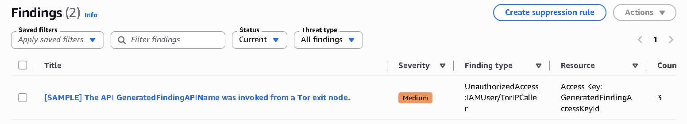
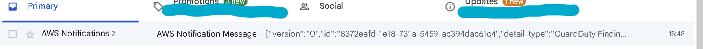

# Phase 3: Visibility (days 8 to 10)

**Goal:** get every security-relevant signal from the account into one queryable
place and prove each source arrives before you try to detect anything. This
mirrors Build 1 Phase 2: visibility first, detections after.

In AWS the "SIEM" is assembled rather than bought: CloudTrail is the audit log,
and you query it with Athena or CloudWatch Logs Insights, route notable events
with EventBridge, and let GuardDuty add managed threat detections on top.

## 3.1 CloudTrail as the audit path

As-built: the trail and its log bucket are Terraform, in `eu-north-1`, alongside
the Phase 2 code (`iac/terraform/cloudtrail.tf`). The trail is applied as
`AdminJITRole`, like every apply since the confidential control went in.

1. A multi-region account trail logs management events (free) to a dedicated,
   locked-down log bucket (`cloud-iam-lab-logs-...`) kept separate from the data
   bucket, with Block Public Access on, ACLs disabled, versioning on, SSE-S3 at
   rest and a non-TLS deny. The bucket policy grants only the CloudTrail service
   principal, pinned to this trail's ARN.
2. A single data-event selector scoped to the Phase 2 data bucket logs object
   reads and writes. S3 data events are paid, so the selector covers that one
   bucket only and the volume stays tiny.
3. Log-file validation is on so tampering is detectable.

**Evidence.** The trail configuration: multi-region, log file validation on, and
SSE-KMS encryption.

## 3.2 Make the logs queryable

1. **Athena:** create a table over the CloudTrail S3 prefix (the AWS console
   offers a one-click CloudTrail Athena setup). Athena bills per terabyte scanned,
   so always query with a date partition and a tight time window.
2. **CloudWatch Logs Insights (optional):** also send the trail to a CloudWatch log
   group if you prefer interactive queries; watch the ingestion cost and keep
   retention short.
3. Decide one primary query surface for Phase 4 and note it in the README; Athena
   over S3 is the cheapest for a lab.

**Evidence.** An Athena query over `cloudtrail_logs` returning management and data
events.

## 3.3 Turn on the managed detections

Enable these together at the start of Phase 3 so the trials run concurrently and
you can tear them down together:

| Source | What it gives | Cost note |
| --- | --- | --- |
| GuardDuty | Managed threat detections over CloudTrail, DNS and S3 | 30-day free trial per account per Region |
| EventBridge | Routes CloudTrail and GuardDuty events to a target | No extra cost for the rules themselves |
| AWS Config | Resource configuration history and rules | Billed per configuration item and rule evaluation (see 3.4) |

Route GuardDuty findings and chosen CloudTrail events through EventBridge to an
SNS topic (email) so a detection surfaces without polling.

**Evidence.** GuardDuty enabled with its protection plans, a sample finding, and
the alert delivered to the inbox through EventBridge and SNS.

## 3.4 The cost trap: AWS Config

AWS Config is required by Security Hub (Phase 5) and bills per configuration item
recorded and per rule evaluation. To keep cost down it is deliberately left off in
Phase 3 and enabled only at the start of Phase 5, when Security Hub actually needs
it, recording only the resource types the lab uses (S3, IAM, KMS, CloudTrail), not
all resources. The setting is noted in `lab-notes.md` and turned off at teardown.
Phase 3 visibility stands on CloudTrail, Athena and GuardDuty without it.

## 3.5 Connect the data sources and confirm arrival

After each source is on, run the harmless action and confirm the event is
queryable.

| Source | Where it lands | Confirm with |
| --- | --- | --- |
| Sign-in / console use | CloudTrail management events | Sign in as `operator`, query `ConsoleLogin` in Athena |
| Role elevation | CloudTrail management events | Assume a lab role, query `AssumeRole` in Athena |
| S3 object access | CloudTrail data events | Read the test object, query `GetObject` on the bucket |
| Managed detections | GuardDuty findings | Confirmed when a finding fires (Phase 4) |

## 3.6 Telemetry coverage table

Build the same kind of coverage table as Build 1: one row per source, where it
lands, what it lets you see, and the result of your arrival test. This is the
artefact that proves visibility before any detection is written.

**Evidence:** `evidence/phase3/telemetry-coverage.md`, plus one screenshot or query
result per source showing the test event.

## Phase 3 deliverables

- `docs/03-visibility.md` write-up.
- `evidence/phase3/telemetry-coverage.md` and arrival query results.
- Commit: `Phase 3: CloudTrail, Athena, GuardDuty and telemetry coverage`.

## Checks before moving on

- A console sign-in by a test user is queryable in Athena within a few minutes.
- A role or policy change you made is in the trail.
- A read of your test object appears as an S3 data event.
- GuardDuty, EventBridge and Config are all on, with the trial windows noted so you
  can time Phase 4.
