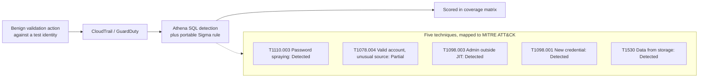
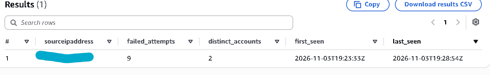
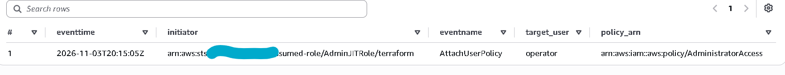
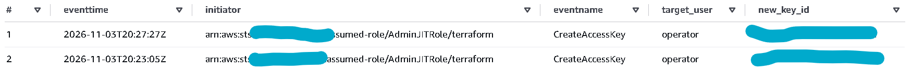
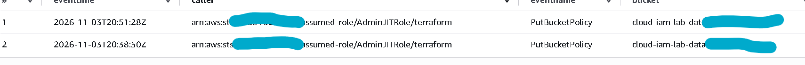
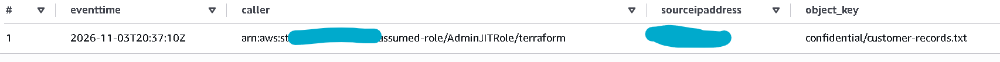

# Phase 4: Simulate and detect

**Goal:** for five cloud techniques, generate a benign signal in your own lab
account, write a detection that catches it, tune out the noise, and score it
honestly as detected, partial or missed. This is detection engineering, the
blue-team half: every "attack" is a harmless action against your own test
identities, run to prove the detection fires.

Scope and safety: all activity is in the lab account, against test identities and
the dummy data you created. Nothing here touches a real account, a real
credential, or a system you do not own. Keep each validation action scripted in
`scripts/` so it is reproducible and obviously benign.

Work one technique at a time, the same loop as Build 1:

1. Run the benign validation action and capture the raw event (an Athena query
   against the CloudTrail table, or the matching GuardDuty finding).
2. Write the detection (Athena SQL or an EventBridge pattern) and a portable Sigma
   version.
3. Tune: note what is noisy, add the exclusions, re-run.
4. Save the alert record and score the result in the coverage matrix.

The queries below assume a CloudTrail Athena table named `cloudtrail_logs`; adjust
the name to match your 3.2 setup, and always include a date-partition and time
filter so Athena scans little.

## Technique map

| Stage | ATT&CK | Benign validation action | Source | Detection |
| --- | --- | --- | --- | --- |
| Initial access | T1110.003 Password spraying | A handful of deliberately wrong console sign-ins across several test users from one host | CloudTrail `ConsoleLogin` | sprayed failures from one source |
| Initial access | T1078.004 Valid cloud accounts | A test-user sign-in from an unusual source you control | GuardDuty, CloudTrail | GuardDuty finding plus anomalous `ConsoleLogin` |
| Privilege escalation | T1098.003 Additional cloud roles | Attach an admin policy directly instead of elevating through the JIT path | CloudTrail `AttachUserPolicy` / `CreateAccountAssignment` | admin grant outside the JIT path |
| Persistence | T1098.001 Additional cloud credentials | Create an access key or a new credential on a test principal | CloudTrail `CreateAccessKey` | new long-lived credential created |
| Collection | T1530 Data from cloud storage | Relax the bucket policy, then read the `confidential/` object | CloudTrail `PutBucketPolicy` + S3 data event | exposure change plus object read |

The detection loop, and the five techniques with their honest scores:



## 4.1 Password spraying (T1110.003)

Benign check: sign in a few test users with a knowingly wrong password from one
machine, so you produce failed sign-ins without locking anything out.

Detection idea: many distinct accounts failing from one source in a short window,
which separates spraying from one user mistyping their own password.

```sql
-- Spray = one source IP, many failed ConsoleLogin accounts, short window
SELECT sourceipaddress,
       count(distinct useridentity.username) AS failed_accounts,
       array_agg(distinct useridentity.username) AS accounts
FROM cloudtrail_logs
WHERE eventname = 'ConsoleLogin'
  AND responseelements['ConsoleLogin'] = 'Failure'
  AND eventtime > to_iso8601(current_timestamp - interval '1' hour)
GROUP BY sourceipaddress
HAVING count(distinct useridentity.username) >= 5
```

Tune: exclude your own test host's IP once validated, or the corporate egress IP
in a real account. Run the query on a 15-minute EventBridge schedule, map to
T1110.003.

**Evidence.** The Athena detection: failed console logins grouped by source,
flagging the sprayed host.



## 4.2 Valid account from an unusual source (T1078.004)

Benign check: sign in as a test user from a source you control that is unusual for
the account (a different network), so GuardDuty raises an anomalous-behaviour or
unusual-console-login finding.

Detection idea: pair the GuardDuty finding with the CloudTrail `ConsoleLogin`, so
the alert shows both the managed detection and the raw sign-in.

```sql
-- Successful console logins, for correlation with the GuardDuty finding
SELECT eventtime, useridentity.username, sourceipaddress,
       additionaleventdata['MFAUsed'] AS mfa_used, awsregion
FROM cloudtrail_logs
WHERE eventname = 'ConsoleLogin'
  AND responseelements['ConsoleLogin'] = 'Success'
  AND eventtime > to_iso8601(current_timestamp - interval '1' hour)
```

Also surface the native GuardDuty finding (for example
`UnauthorizedAccess:IAMUser/ConsoleLogin` family) via EventBridge. Score: detected
and, where the G1 MFA guardrail or G2 source-IP guardrail would have blocked it,
prevented too, the control-plus-detection story Build 1 told with the LSASS block.

## 4.3 Admin granted outside the JIT path (T1098.003)

Benign check: attach an administrative policy or create an account assignment
directly to a test principal, rather than using the Phase 1 just-in-time path.
Remove it afterward.

Detection idea: a privileged grant that is a direct attachment, not the expected
JIT elevation.

```sql
SELECT eventtime, useridentity.arn AS initiator, eventname,
       requestparameters
FROM cloudtrail_logs
WHERE eventname IN ('AttachUserPolicy', 'AttachRolePolicy',
                    'PutUserPolicy', 'CreateAccountAssignment')
  AND eventtime > to_iso8601(current_timestamp - interval '1' hour)
```

Tune: the JIT elevation path has a known initiator and session tag; keep only
grants that are not that path. Map to T1098.003.

**Evidence.** The Athena detection: an administrative policy attached outside the
just-in-time path.



## 4.4 New credential on a principal (T1098.001)

Benign check: create an access key on a test IAM user (or add a credential to a
test principal), then delete it.

Detection idea: a new long-lived credential is a common cloud persistence step and
is rare in a small, role-based lab account where access keys should almost
never be created.

```sql
SELECT eventtime, useridentity.arn AS initiator, eventname,
       requestparameters['userName'] AS target_user
FROM cloudtrail_logs
WHERE eventname IN ('CreateAccessKey', 'CreateLoginProfile',
                    'CreateServiceSpecificCredential')
  AND eventtime > to_iso8601(current_timestamp - interval '1' hour)
```

Tune: allowlist any known automation that legitimately rotates credentials. In
this lab there should be none, which is the point. Map to T1098.001.

**Evidence.** The Athena detection: a new long-lived credential created on a test
principal.



## 4.5 Storage exposure and read (T1530)

Benign check: relax the bucket policy on the storage bucket (for example remove
the VPC-endpoint condition, or add a broad statement), then read the
`confidential/` object, then restore the policy. This models a misconfiguration
leading to data access.

Detection idea: tie the configuration change (control plane) to the object read
(data plane), so the alert tells the whole story.

```sql
-- Control-plane: the bucket policy was changed
SELECT eventtime, useridentity.arn AS caller, eventname,
       requestparameters['bucketName'] AS bucket
FROM cloudtrail_logs
WHERE eventname IN ('PutBucketPolicy', 'PutBucketPublicAccessBlock',
                    'DeleteBucketPolicy')
  AND eventtime > to_iso8601(current_timestamp - interval '1' hour)
```

```sql
-- Data-plane: read of a confidential object
SELECT eventtime, useridentity.arn AS caller, sourceipaddress,
       requestparameters['key'] AS object_key
FROM cloudtrail_logs
WHERE eventname = 'GetObject'
  AND requestparameters['key'] LIKE 'confidential/%'
  AND eventtime > to_iso8601(current_timestamp - interval '1' hour)
```

Score: detected on both planes. Note the preventive control (Block Public Access
and the VPC-endpoint condition should stay on, protected by the G5 SCP) alongside
the detection.

**Evidence.** The matched pair: the control-plane change to the bucket exposure,
and the data-plane read of the confidential object.




## Sigma versions

Write one Sigma rule per technique in `detections/sigma/`, product `aws` /
service `cloudtrail`, with a valid UUIDv4 each (generate with
`python -c "import uuid;print(uuid.uuid4())"`, never hand-typed). Map each to the
CloudTrail `eventName` fields above. These are the portable record that the same
detections would work in another SIEM.

## Phase 4 deliverables

- `detections/aws/*.sql` (Athena) and any EventBridge patterns as JSON.
- `detections/sigma/*.yml` with valid UUIDs.
- `evidence/phase4/`: per-technique file with the validation action, the raw
  event, the alert record, the tuning note, and the score.
- `evidence/phase4/coverage-matrix.md`.
- Commit: `Phase 4: five cloud detections with coverage matrix`.

## Checks before moving on

- Each detection fires on its validation action and is quiet otherwise.
- The coverage matrix scores all five honestly, with any "partial" explained.
- Every "detected" row has its alert record saved next to it (the Build 1 review
  lesson: proof lives beside the claim).
