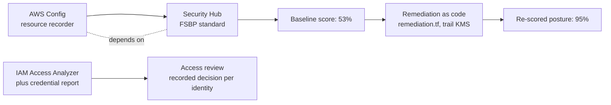
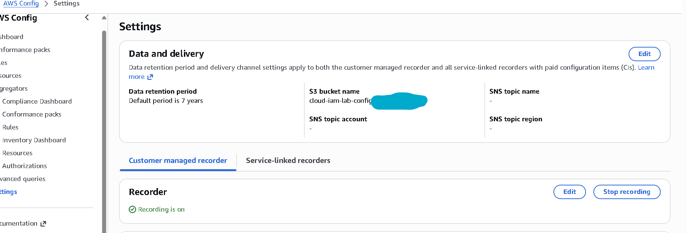
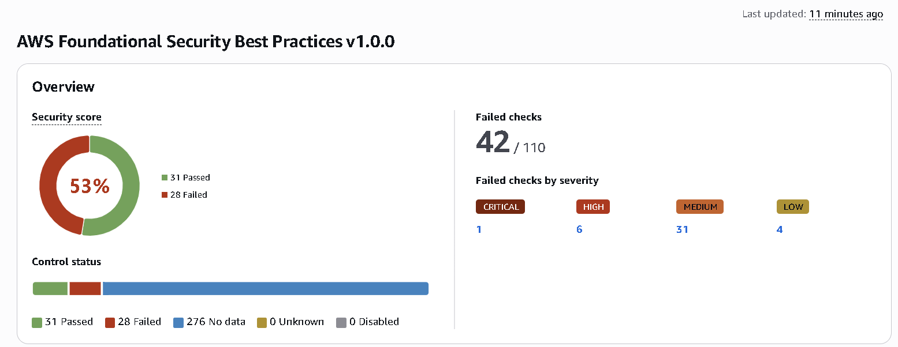
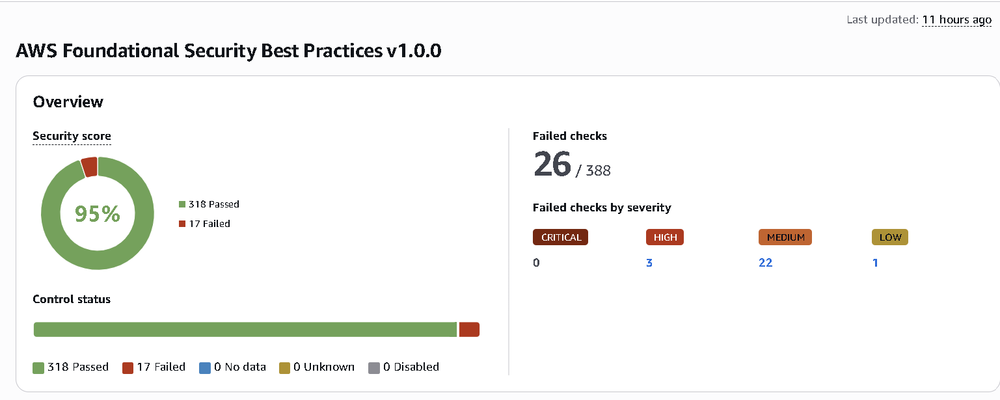
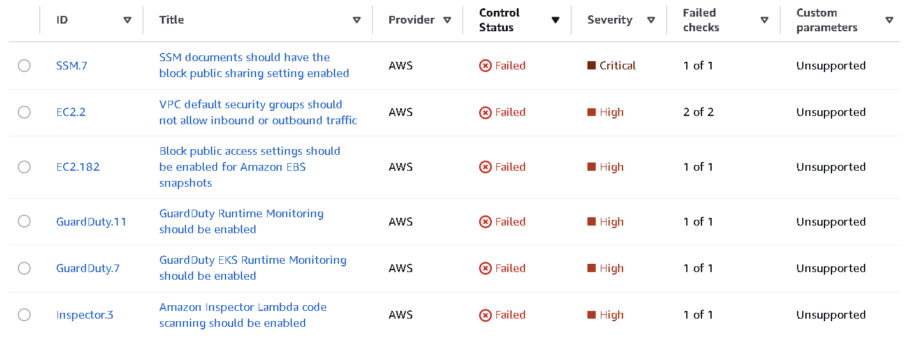
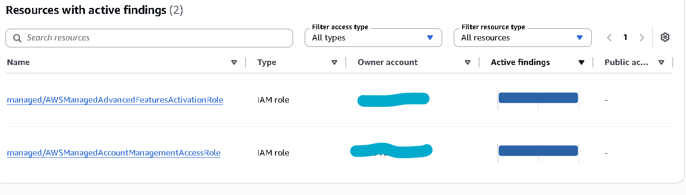

# Phase 5: Posture and access review

**Goal:** measure the account's security posture before and after remediation, and
run one access review, so the build shows the governance half of cloud security,
not just detections. Same honesty rule as Build 1: the figures show improvement,
not formal compliance.

The posture loop, from baseline through remediation to re-score and access review:

## 5.1 Baseline the scores

1. **Security Hub security score:** enable AWS Security Hub in `eu-north-1` with the
   AWS Foundational Security Best Practices standard (and CIS if you want a second
   view). Security Hub depends on AWS Config, so confirm Config is on and scoped as
   in Phase 3.4. Record the starting score and the top failed controls.
2. **IAM Access Analyzer and the credential report:** run an account credential
   report and an Access Analyzer scan for external access. Record unused
   credentials, over-broad policies and any resource shared outside the account.

Screenshot both before you change anything. Security Hub has a 30-day free trial;
GuardDuty's findings feed into it.

**Evidence.** The AWS Config recorder on, which Security Hub depends upon.

## 5.2 Remediate the top items

Work the highest-weight findings that fit the lab, for example:

- MFA enforced for all human access (handled by the G1 guardrail).
- No long-lived access keys on human identities (federated or role-based access).
- Least privilege on the lab roles, no standing `AdministratorAccess`.
- S3 Block Public Access and secure-transport (already set in Phase 2).
- Root user credential-less under centralized root access.

Record each change and why. Re-run the Security Hub score and the Access Analyzer
scan and capture the after figures.

## 5.3 Access review

1. Use the account credential report and IAM Access Analyzer to list every human
   identity and its permission-set assignments.
2. Review who can assume the privileged lab roles (the three MFA-gated roles).
3. As the reviewer, approve or remove each, record the outcome.

This demonstrates the periodic-review control a bank's IAM function runs, and it
ties back to the joiner-mover-leaver story in the report. AWS has no single
packaged "access review" like Entra, so the review is the documented, repeatable
use of Access Analyzer plus the credential report, which is itself a good talking
point.

## Phase 5 deliverables

- `docs/05-posture.md` with before and after scores and a table of fixes.
- `evidence/phase5/`: Security Hub score before and after, Access Analyzer and
  credential-report results, access-review decisions.
- Commit: `Phase 5: posture improvement and access review`.

## Checks before moving on

- The Security Hub score improved, with no new high-severity finding introduced.
- The write-up states plainly that the score measures improvement, not compliance
  or certification.
- The access review has a recorded decision for every reviewed identity.

## As-built results (2026-11-05)

### Scores

Baseline: **53 percent** (31 controls passed, 28 failed, over the 59 controls that
had data at the time). After remediation: **95 percent** (318 controls passed, 17
failed). The 17 still-failing controls carry 26 individual failed checks: 0
critical, 3 high, 22 medium, 1 low. Every one of the eleven controls fixed in 5.2
now passes and no new failure was introduced; the 17 that remain are exactly the
accepted set described below, each needing a paid service or a workload the lab
deliberately does not run, or a documented design choice.

Two points of honesty about the headline figure. First, the number of controls
with data grew from 59 at baseline to 335 after, because Security Hub accumulated
evaluation data for many more controls over the period. A large share of the added
passes are controls that pass by default for resource types the lab does not run
(for example, a control on a database engine that is absent counts as passed). So
the move from 53 to 95 percent reflects both the real fixes and this wider
evaluated set, and the realised figure came out above the 71 percent first
projected over the smaller baseline set. Second, the score measures improvement
against best practice; it is not compliance or certification.

Evidence: `evidence/phase5/securityhub-baseline.md` for the baseline and triage,
and the before and after console scores below.

### Fixes applied

| Control | Severity | Change | Mechanism |
| --- | --- | --- | --- |
| SSM.7 | Critical | Block public sharing of SSM documents | Terraform |
| EC2.2 | High | Removed all rules from both default security groups | Terraform |
| EC2.182 | High | Account block public access for EBS snapshots | Terraform |
| EC2.7 | Medium | EBS default encryption enabled | Terraform |
| EC2.172 | Medium | VPC Block Public Access, block internet gateway traffic | Terraform |
| S3.1 | Medium | Account-level S3 Block Public Access | Terraform |
| IAM.7 | Medium | Strong account password policy | Terraform |
| EC2.15 | Medium | Default subnets no longer auto-assign public IPs | Terraform |
| S3.13 | Low | Lifecycle rules on all three buckets | Terraform |
| CloudTrail.2 | Medium | Dedicated KMS key encrypts the trail at rest | Terraform |
| Account.1 | Medium | Account security contact set | CLI (keeps contact details out of the repository) |

All applied through `iac/terraform/remediation.tf` and the trail KMS change in
`cloudtrail.tf`, except the security contact, which was set by CLI. Note: after
the trail KMS change, read CloudTrail logs in Athena as AdminJITRole or
ContributorRole; ReadOnlyRole cannot decrypt the new log files.

### Controls accepted with reason

Seventeen controls were accepted rather than fixed, because each needs a paid
service or a workload the lab deliberately does not run, or is a documented design
choice: GuardDuty runtime monitoring (four controls) and Inspector and Macie
(paid, no compute or Lambda); the paid interface VPC endpoints EC2.10, EC2.55 to
EC2.58 and EC2.60 (services not used); S3.9 and CloudTrail.5 (object access and
query and alerting already covered by CloudTrail data events, Athena and
GuardDuty to EventBridge to SNS); SSM.6 (no automation in use); IAM.2 (operator is
a single base identity whose only permission is an MFA-gated role assumption, by
design); and EC2.6 (no instances or traffic to log). Full table in
`evidence/phase5/securityhub-baseline.md`.

### Root user control

The workload account root holds **no credentials**: no password, no access keys
and no MFA. Under AWS Organizations this credential-less state is the recommended
posture and is stronger than placing a password and MFA on the member root.
**Centralized root access** is enabled, so any root action on a member account is
brokered from the management account, whose own root is protected by MFA. The FSBP
control IAM.6 (hardware MFA on root) returned "no data" at baseline, because there
were no member root credentials to evaluate; in the after export it evaluates as
passed, consistent with the credential-less design.

### Access review

Every identity and external-access path was reviewed with a recorded decision:
`operator` kept (MFA, least privilege, one recognised base key); the three
assumable roles kept (no standing administrator, admin only through the one-hour
MFA-gated AdminJITRole); and the two IAM Access Analyzer findings marked intended
(expected AWS Organizations management access). Detail in
`evidence/phase5/access-review.md`.

**Evidence.** The two expected IAM Access Analyzer external-access findings.

### Reproduce

From `iac/terraform`: `source scripts/assume-role.sh <MFA> AdminJITRole`, then
`terraform apply -var="alert_email=<email>"`. Re-export the FSBP controls CSV from
Security Hub, Standards, to capture the after score.
