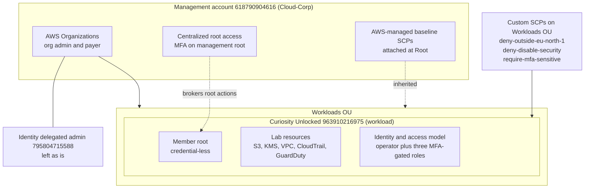
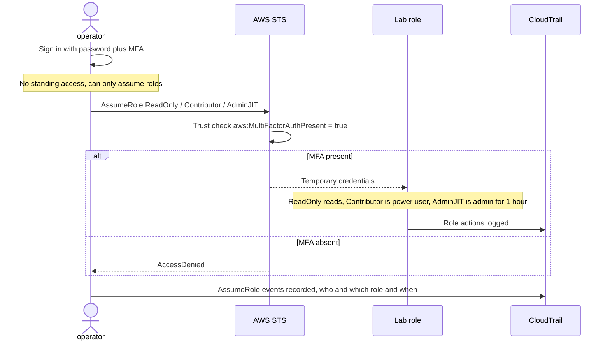
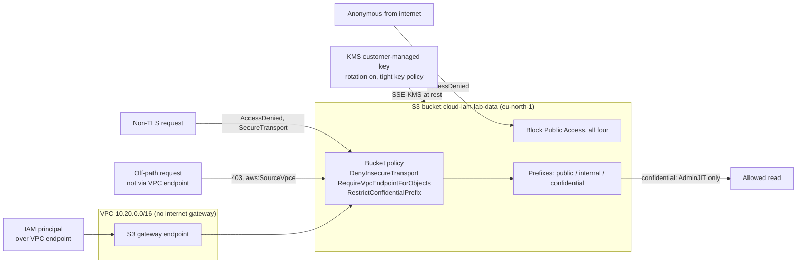
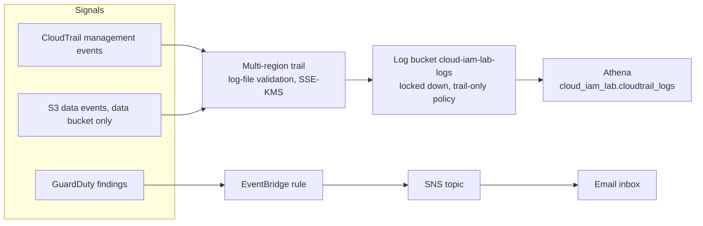
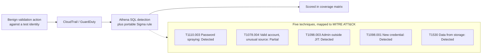
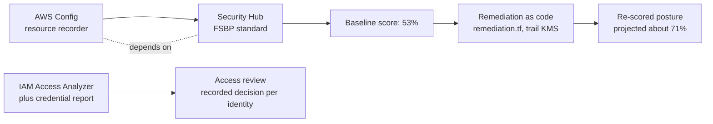
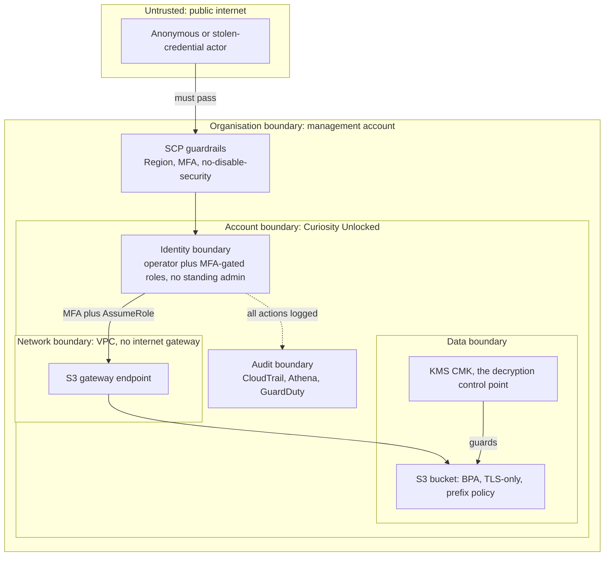

# Architecture and workflow diagrams

A high-level view of the lab: the organisation and account topology, the identity
and access flow, the data-protection architecture, the visibility and detection
pipelines, the posture loop, and the trust boundaries the controls defend. Each
diagram is Mermaid and renders inline on GitHub, so it stays in version control
and tracks the build as it changes. The detail behind each view is in the phase
guides under [docs/](README.md) and the evidence under `evidence/`.

## 1. Organisation and account topology

Guardrails live in the management account; the access model and every lab resource
live in the workload account. Service control policies bind the `Workloads` OU, so
they constrain the workload account but never the management account.

## 2. Identity and just-in-time elevation

The daily `operator` identity holds no power of its own. It can only request a
role, and the role answers only when the sign-in carried MFA. Administrative
access is never standing; it is assumed for a short, logged window and dropped.

## 3. Data-protection architecture

The bucket is reachable only by an IAM principal, over the private VPC path, with
the customer-managed key. Every other path is denied, and the failures are the
evidence (Phase 2).

## 4. Visibility and telemetry pipeline

Every security-relevant signal lands in one queryable place, and a notable finding
surfaces without polling (Phase 3).

## 5. Detection engineering flow

For each technique, a benign validation action produces a signal, a detection
catches it, and the result is scored honestly in the coverage matrix (Phase 4).

## 6. Posture and governance loop

Measure the posture, remediate the highest-weight findings as code, re-score, and
run a documented access review (Phase 5).

## 7. Trust boundaries

What an action must cross to reach the data, and the control that guards each
boundary. An attacker who compromises a credential still meets MFA-gated
elevation, a network with no internet path to the bucket, encryption under a key
they do not control, and an audit trail that records the attempt.

## How to read these

The diagrams are intentionally high level: they show the control relationships,
not every resource. For the exact configuration, the Terraform in
[iac/terraform/](../iac/terraform/) is the source of truth, the phase guides give
the step-by-step build, and the console screenshots embedded in those guides and
in `evidence/` show each control as it actually appears.
