# Phase 1 walkthrough: the access model we built

This is the hands-on, as-built record of Phase 1 for this organisation. It
documents the identity and access model exactly as it was stood up and verified,
so it differs in one deliberate way from the design in
[01-identity.md](01-identity.md): the live build uses **IAM roles** in the
workload account rather than IAM Identity Center permission sets. The reason is
recorded below, and the control outcome (no standing privilege, MFA-gated access,
just-in-time admin, full audit trail) is identical.

Everything in this phase is free. IAM identities are global, and the lab's
workload Region is **`eu-north-1`** (the one Region the account's AWS-managed
region guardrail leaves open; London `eu-west-2` was not available). The UK
framing lives in the report, not the Region.

## Why IAM roles, not Identity Center permission sets

The organisation's IAM Identity Center instance could not expose multi-account
permission sets (the "Multi-account permissions" and "Permission sets" menus were
absent in both the management and delegated-administrator accounts, in the
instance's home Region, as a confirmed organisation instance). Rather than stall
the phase on a console limitation, the access model was built with IAM roles in
the workload account, which delivers the same least-privilege and just-in-time
story and is a pattern a technology-risk interviewer recognises immediately. The
report notes that a production landing zone would front these roles with Identity
Center or an external IdP; the control design does not change.

## The accounts (where each step runs)

| Account | ID | Role in the lab | What happens here |
| --- | --- | --- | --- |
| Cloud-Corp Management Account | 618790904616 | Organisation admin and payer | Organisation structure, SCPs, billing, budgets |
| Curiosity Unlocked | 963910216975 | Workload (member) account, holds the credit | The access model and all later phases |
| Cloud-Corp Identity Delegated Admin | 795804715588 | Auto-created Identity Center admin | Left as is |

Rule of thumb: **guardrails are set in the management account; the access model
and the lab's resources live in Curiosity Unlocked.**

**Evidence.** The organisation structure: the management account and the
`Workloads` OU holding Curiosity Unlocked.

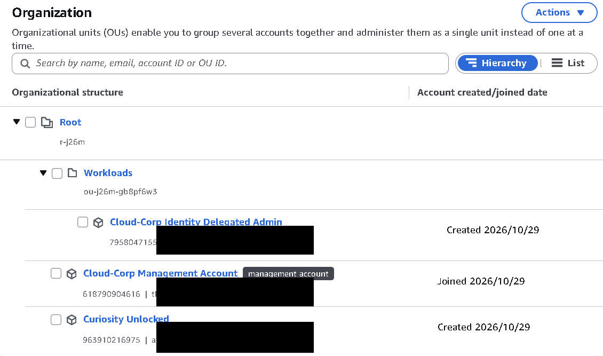

## The access model at a glance

One daily identity with no power of its own, and three roles it can borrow only
with MFA. Admin is never standing; it is assumed for a short, logged window and
dropped.

| Principal | Standing permission | How access is obtained | Session |
| --- | --- | --- | --- |
| `operator` (IAM user) | None but `sts:AssumeRole` on the three roles | Signs in with password plus MFA | n/a |
| `ReadOnlyRole` | `ReadOnlyAccess` | Assumed by any MFA'd principal in the account | default |
| `ContributorRole` | `PowerUserAccess` | Assumed by any MFA'd principal in the account | default |
| `AdminJITRole` | `AdministratorAccess` | Assumed by any MFA'd principal in the account | 1 hour max |
| account root | full | Break-glass only, credential-less with centralized root access | n/a |

**Evidence.** The workload account's root user is credential-less; root actions
are brokered centrally from the organisation (centralized root access).

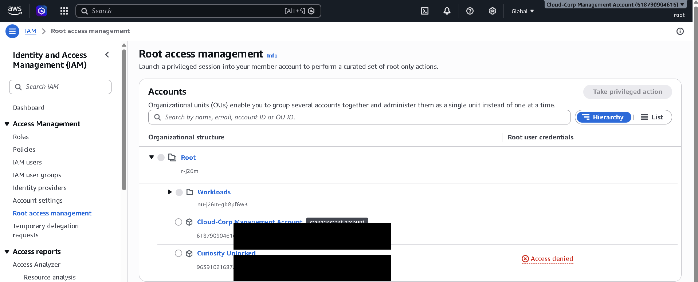

## Step 1: The three roles (IAM, Curiosity Unlocked)

Each role uses the same custom trust policy, which allows any identity in the
account to assume it **only when MFA is present**. The permissions differ per
role.

1. **IAM** > **Roles** > **Create role** > **Custom trust policy**.
2. Paste the trust policy from [`config/iam/trust-policy-mfa.json`](../config/iam/trust-policy-mfa.json)
   (the `963910216975` account root principal with the
   `aws:MultiFactorAuthPresent` condition). Next.
3. Attach the managed policy for the role, name it, create:

| Role | Managed policy | Extra |
| --- | --- | --- |
| `ReadOnlyRole` | `ReadOnlyAccess` | none |
| `ContributorRole` | `PowerUserAccess` | none |
| `AdminJITRole` | `AdministratorAccess` | set **Maximum session duration = 1 hour** on the role summary |

**Evidence.** The three roles in the Roles list, the AdminJITRole summary showing
the one hour maximum session duration, and the shared custom trust policy that
requires MFA.

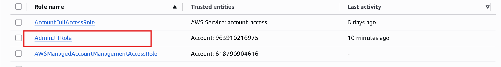
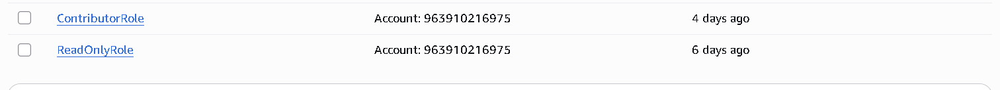
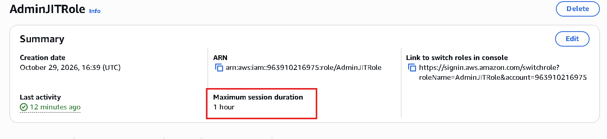
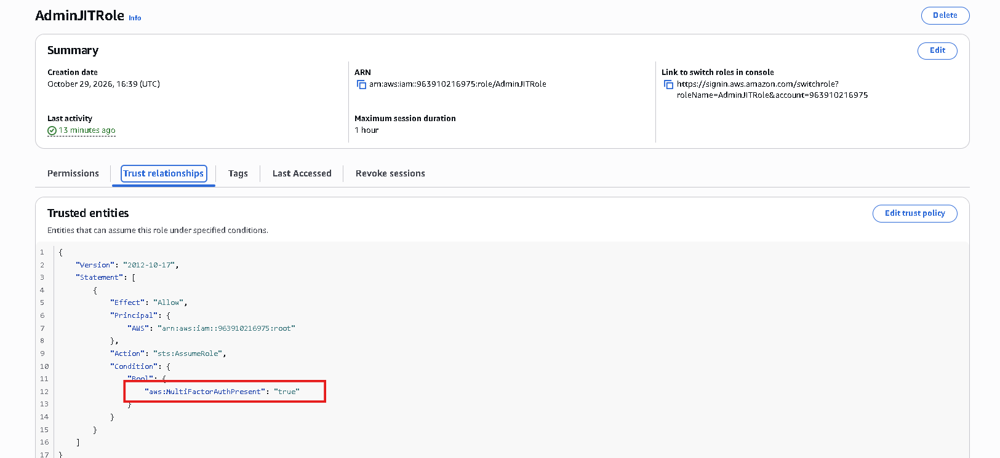

## Step 2: The daily operator user (IAM, Curiosity Unlocked)

1. **IAM** > **Users** > **Create user** > name `operator` > provide console
   access as an IAM user, set a password (**never recorded in the repo, notes, or
   memory**). Attach no managed policy at creation.
2. Open `operator` > **Permissions** > **Add permissions** > **Create inline
   policy** > **JSON** > paste [`config/iam/operator-assume-lab-roles.json`](../config/iam/operator-assume-lab-roles.json)
   > name it `assume-lab-roles` > create.

The whole point: `operator` can read nothing and change nothing on its own. Its
only power is to request a role, and the role answers only with MFA.

**Evidence.** The operator Permissions tab: a single inline policy and no managed
policies.

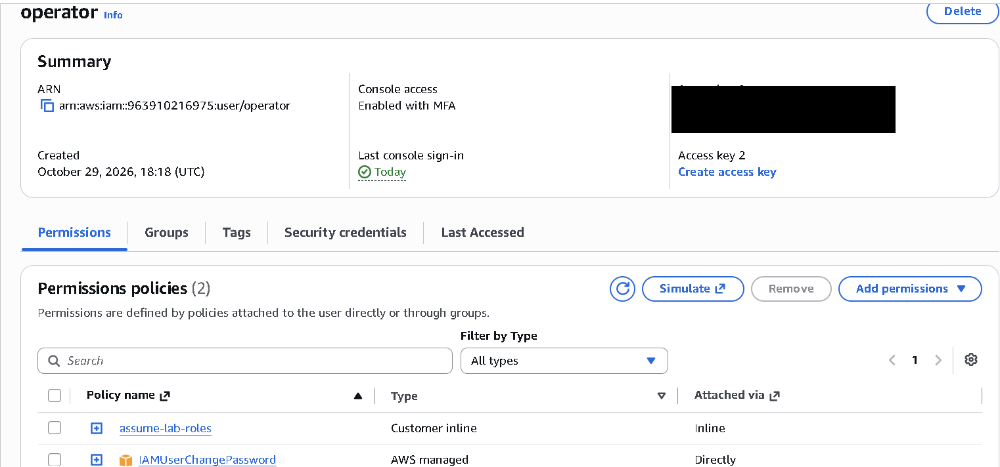

## Step 3: MFA on the operator

1. `operator` > **Security credentials** > **Multi-factor authentication (MFA)**
   > **Assign MFA device** > name `operator-mfa` > **Authenticator app** > scan
   the QR code with an authenticator app > enter two consecutive codes > add.

**Evidence.** The operator Security credentials page with an MFA device assigned.

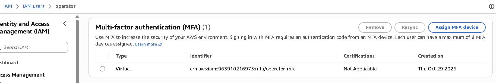

## Step 4: Verify the model (incognito sign-in)

Do this in a private window so it does not disturb the admin session.

1. Sign in at `https://963910216975.signin.aws.amazon.com/console` as `operator`
   (password plus MFA).
2. **No standing access:** open S3, EC2 or IAM. Every service returns Access
   denied. Correct.
3. **Read after one switch:** account menu > **Switch role** > account
   `963910216975`, role `ReadOnlyRole`. S3 is now viewable, but create or delete
   is denied. Read, not write.
4. **Just-in-time admin:** Switch role again to `AdminJITRole`. Full admin is now
   available and the session is capped at 1 hour. **Switch back** to drop it and
   return to the powerless operator.
5. The switches worked only because the sign-in carried MFA; without it the roles
   refuse.

**Evidence.** The denied state before any switch, and the read-only state after
one switch. The admin state is evidenced by the one hour session cap in Step 1 and
the `AssumeRole` records in Step 5.

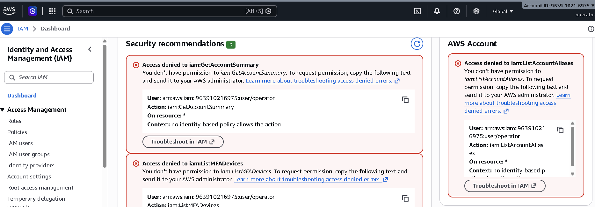
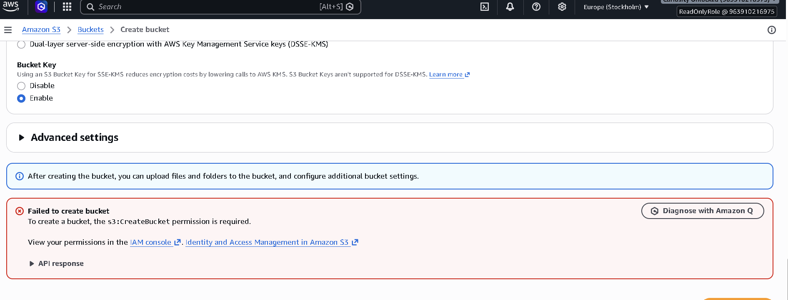

## Step 5: The audit trail (CloudTrail, admin window)

1. In the management or admin window (not the operator session), open
   **CloudTrail** > **Event history**.
2. Set the lookup attribute to **User name** = `operator`.
3. The `AssumeRole` events for ReadOnlyRole and AdminJITRole appear with the
   timestamp, source IP and MFA context. Event history can lag up to about 15
   minutes.

This is the audit answer to "who elevated, to what, and when". From Phase 3 a
dedicated trail and Athena turn this into queryable detections.

**Evidence.** The operator `AssumeRole` rows in CloudTrail Event history.

## Step 6: Guardrails with SCPs (Organizations, management account)

Service control policies are the organisation-wide deny guardrails. Attach them
to the `Workloads` OU so they bind Curiosity Unlocked but never the management
account.

1. **Organizations** > **Policies** > **Service control policies** > enable if
   needed.
2. Start with a single Region deny and confirm you can still work, then add the
   others one at a time. **Exempt the global and sign-in services** or the policy
   breaks sign-in and administration. Exempt at least `iam`, `sts`,
   `organizations`, `sso`, `sso-directory`, `identitystore`, `cloudfront`,
   `route53`, `support`, `budgets`, `cur`.

| Policy | What it denies | Key condition |
| --- | --- | --- |
| `deny-outside-eu-north-1` | Any action in another Region | `aws:RequestedRegion` not `eu-north-1`, global and sign-in services exempted |
| `deny-disable-security` | Turning off the audit path | `cloudtrail:StopLogging`, `config:Delete*`, loosening S3 public-access block |
| `require-mfa-sensitive` | Sensitive actions without MFA | `aws:MultiFactorAuthPresent` = false on chosen actions |

3. Validate with the **IAM policy simulator** or by attempting a denied action and
   reading the deny in CloudTrail.

**Evidence.** The service control policies attached to the `Workloads` OU, and the
`require-mfa-sensitive` policy detail. Each SCP JSON is in `config/scp/`.

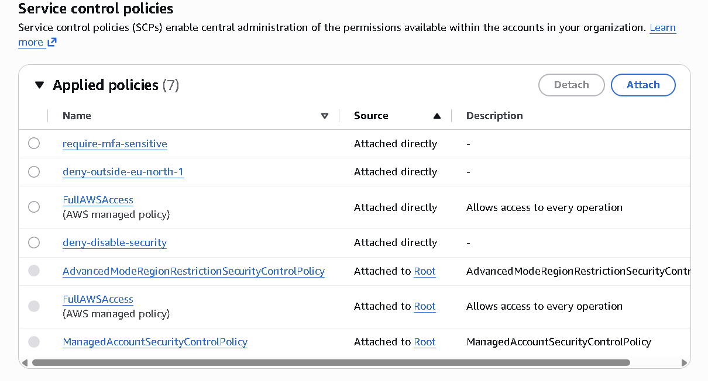
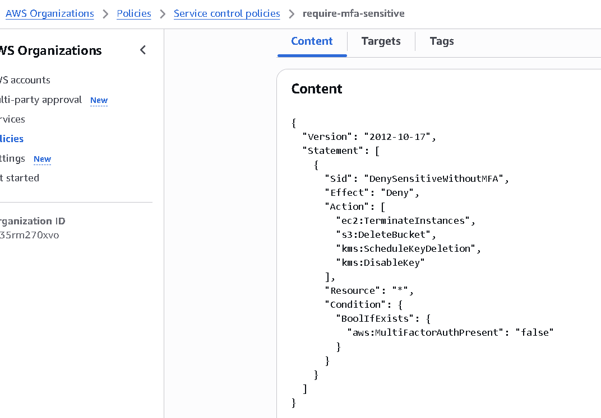

## Phase 1 deliverables

- This walkthrough and the access-model table above.
- `config/iam/trust-policy-mfa.json`, `config/iam/operator-assume-lab-roles.json`,
  and the three role definitions in `config/iam/roles.md`.
- `config/scp/*.json` once Step 6 is done.
- `evidence/phase1/`: three roles, AdminJITRole 1 hour cap, operator permissions,
  operator MFA, the denied/read/admin states, the CloudTrail `AssumeRole` rows, a
  denied-action or simulator result.
- Commit: `Phase 1: identity and access model (IAM roles, JIT, SCP)`.

## Checks before moving on

- `operator` has no standing access and an MFA device.
- `operator` reads only after assuming `ReadOnlyRole`, and cannot write.
- `AdminJITRole` grants admin only when assumed, and the session lapses in an hour.
- CloudTrail shows the `AssumeRole` events for the elevations.
- An action outside `eu-north-1` is denied on Curiosity Unlocked once Step 6 is in,
  while the management account is unaffected.
