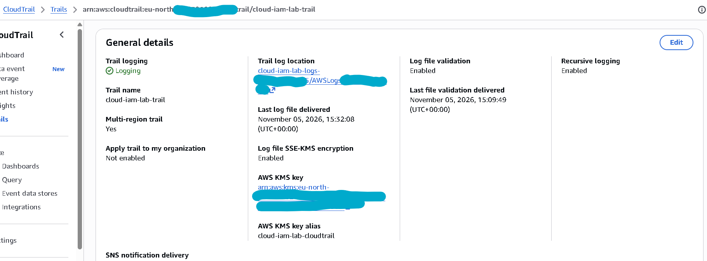
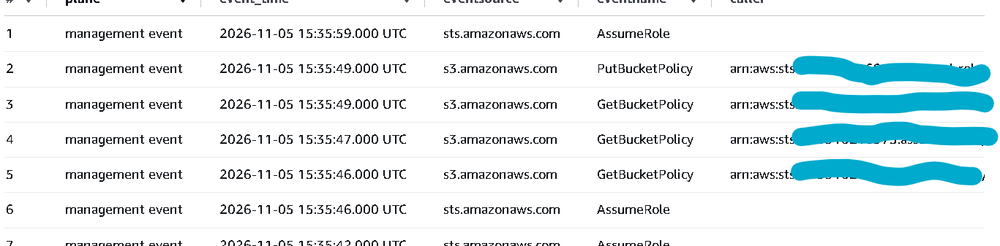
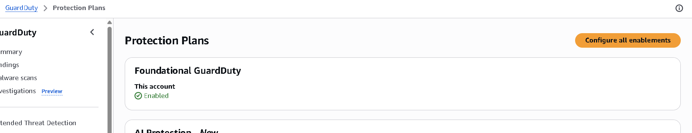
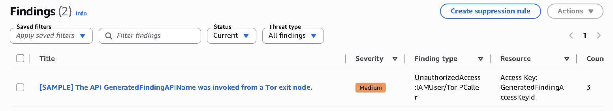

# Phase 3 evidence

Visibility over the account: CloudTrail delivering to a queryable log bucket,
Athena over the trail, and GuardDuty findings routed to an inbox. Full write-up in
[docs/03-visibility.md](../../docs/03-visibility.md).

- [`telemetry-coverage.md`](telemetry-coverage.md): the telemetry coverage table,
  mapping each source (CloudTrail management events, S3 data events, GuardDuty) to
  what it records and where it lands, with the end-to-end proofs.
- `raw/`: supporting captures, git-ignored.
  - `management-events-arrival.csv`: management events arriving in the trail.
  - `data-event-getobject.csv`: an S3 object-level `GetObject` data event.

## Screenshots

