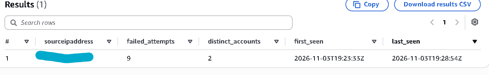
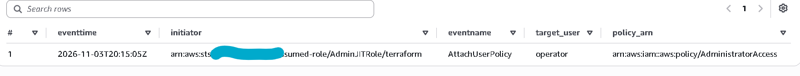
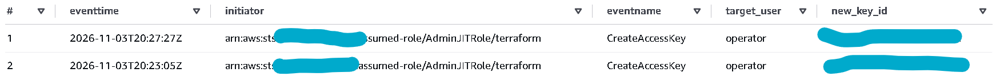
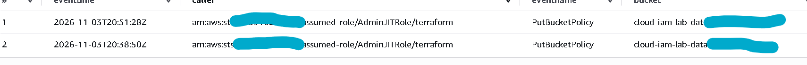
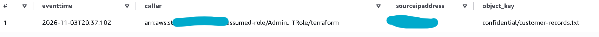

# Phase 4 evidence

Five cloud attack techniques, each validated with a benign action against the
lab's own test identities, with the alert record kept beside the claim. Full
write-up in [docs/04-detections.md](../../docs/04-detections.md).

Start with the coverage matrix, then the per-technique records:

- [`coverage-matrix.md`](coverage-matrix.md): all five techniques at a glance,
  mapped to MITRE ATT&CK, with the detection outcome for each.
- [`01-password-spraying.md`](01-password-spraying.md): T1110.003.
- [`02-valid-account-unusual-source.md`](02-valid-account-unusual-source.md): T1078.004.
- [`03-admin-outside-jit.md`](03-admin-outside-jit.md): T1098.003.
- [`04-new-credential.md`](04-new-credential.md): T1098.001.
- [`05-data-from-storage.md`](05-data-from-storage.md): T1530.
- `raw/`: the underlying Athena result and query CSVs, git-ignored.

Each record states the technique, the benign validation action, the Athena
detection and its result, and an honest score of whether the detection fired.

## Screenshots

Athena detection results (home IP redacted where a source address appears):

