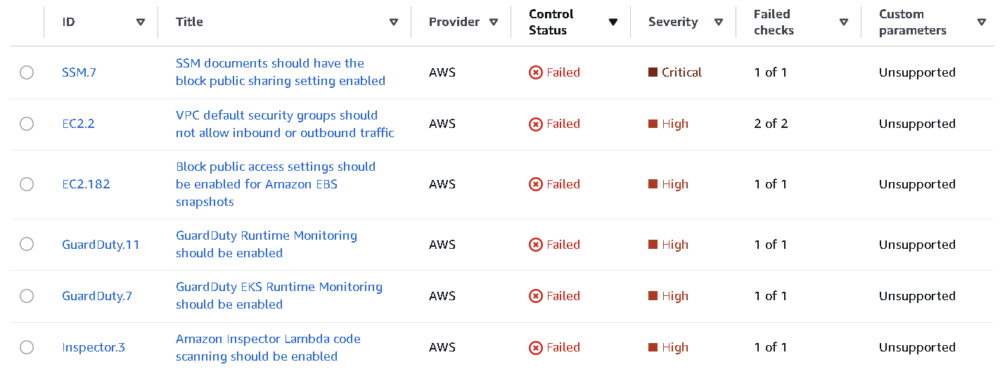
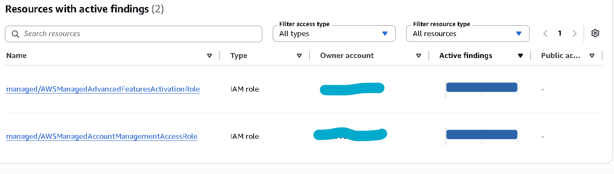
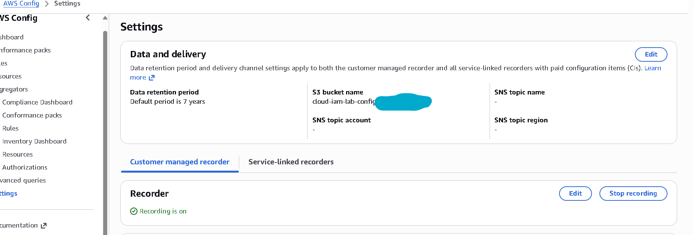
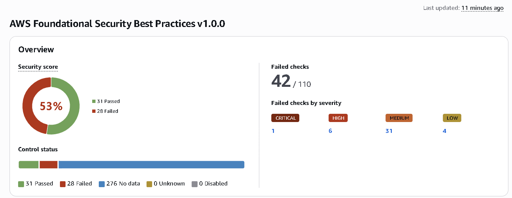
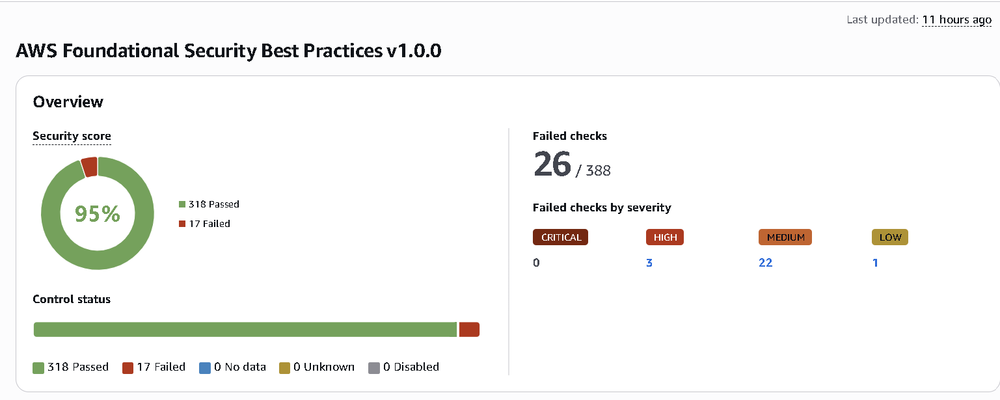

# Phase 5 evidence

Security posture measured before and after remediation, plus a documented access
review. Full write-up in [docs/05-posture.md](../../docs/05-posture.md).

- [`securityhub-baseline.md`](securityhub-baseline.md): the Security Hub FSBP
  baseline score (53 percent) and the full remediation triage, every failed
  control sorted into fix or accept with a reason.
- `securityhub-score-before.png`: the console score before remediation (53 percent).
- `securityhub-score-after.png`: the console score after remediation (95 percent).
- [`credential-report.md`](credential-report.md): the decoded IAM credential
  report, one input to the access review.
- [`access-analyzer-findings.md`](access-analyzer-findings.md): the IAM Access
  Analyzer external-access findings, the other input.
- [`access-review.md`](access-review.md): every identity and access path reviewed
  with a recorded decision.
- `raw/`: the full FSBP control export, git-ignored.

## Screenshots

The score before remediation (53 percent) and after (95 percent):

