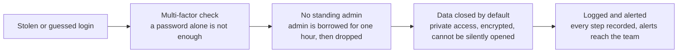

# Business stakeholder report

| Field | Value |
| --- | --- |
| Document | Cloud identity and access control: business report |
| Account | Lab AWS account (963910216975), Region eu-north-1 |
| Date | 2026-11-05 |
| Author | Amit Kiran Deb |
| Audience | Business and risk stakeholders |

## 1. Executive summary

This project built and tested a set of identity and access controls in an AWS cloud
account, on the principle that in the cloud the primary perimeter is identity
rather than the network. The question it set out to answer was direct: if a single
cloud login were compromised, would the controls hold, and would the activity be
seen.

A controlled exercise ran five common attacker techniques against the account's
test identities. Four of the five were detected outright and the fifth was covered
by the cloud provider's managed detection service. The preventive controls,
multi-factor authentication, time-limited administrative access, and
default-closed data storage, constrained what a compromised login could achieve at
each step. The conclusion is that a single identity compromise in this account
would be contained and visible, which supports keeping the impact of such an event
within a tolerable range for any service that depends on it.

The work is a controlled exercise in a lab account, not a production system or a
real incident. It demonstrates the control design and the evidence behind it; it is
not a compliance certification.

## 2. Background and objective

Most cloud security incidents begin with a credential that is guessed, phished, or
found to have more access than it should. Once an attacker holds a valid login,
network defences are largely bypassed, because the attacker is now inside, acting as
a trusted identity. The objective of this build was therefore to treat identity as
the control point and to prove, with evidence, that the account could both prevent
and detect the typical steps of an identity-driven attack.

## 3. What was delivered

The account now runs on the following control areas, each built as code so it is
repeatable and auditable:

| Control area | In business terms | Outcome |
| --- | --- | --- |
| Access model | One everyday login with no power of its own; stronger access is borrowed, not held | No standing privileged access |
| Administrative access | Administrator rights are granted only for a capped one-hour window and then dropped | No permanent administrators |
| Strong authentication | A second factor is required before any meaningful access is granted | A stolen password alone is not enough |
| Data protection | Sensitive data is private by default, encrypted with a key the account controls, and cannot be silently exposed | Data stays closed unless deliberately opened |
| Monitoring | Every action is recorded, and threats raise alerts that reach the team | Activity is visible and actionable |
| Governance | A documented access review confirms who can do what | Access is reviewed and recorded |

## 4. How the controls hold

The controls are layered, so a compromised login meets a series of independent
barriers rather than a single gate. Each layer either stops the activity or limits
what it can reach, and the final layer ensures the attempt is seen.

The practical effect is that losing one login does not mean losing the account. The
login carries no standing power, the routes to greater access are gated by a second
factor and are time limited, the data is closed by default, and the whole path is
recorded.

## 5. Validation and results

The controls were tested with a controlled exercise that walked through five
attacker techniques in the order a real intrusion would follow. The techniques are
mapped to MITRE ATT&CK, the recognised industry catalogue of attacker behaviour, so
the coverage can be assessed against a common standard.

| Attacker move | What it represents | Result |
| --- | --- | --- |
| Password spraying | Guessing passwords across accounts | Detected |
| Valid login from an unusual source | A genuine login used from an attacker's location | Covered by managed detection (see note) |
| Administrator granted directly | Giving a login permanent admin rights | Detected |
| New long-lived key created | Planting a durable credential to persist | Detected |
| Confidential data read after an exposure change | Reading protected data after weakening a control | Detected |

Note on the second technique: a genuine unusual-location login could not be staged
in a single-location lab, so it relies on the cloud provider's managed detection
service (GuardDuty), whose alerting was separately proven to reach an inbox. In a
real estate with many users and locations, this would be detected directly. The
result is recorded honestly rather than overstated. The full technical detail and
evidence are in the incident report and the phase evidence.

## 6. Operational resilience assessment

For a regulated firm, the relevant question is whether an important business service
would remain within its impact tolerance, the maximum level of disruption the firm
judges it can absorb, if an identity were compromised. Framed against the UK
regulators' operational resilience expectations (the PRA and the FCA):

- **Confidentiality of data.** Access to sensitive data is limited to a single
  administrative path and is logged, so exposure from one compromised login is
  contained rather than open-ended.
- **Control and recovery.** Because administrative rights are temporary and every
  change is recorded, an unexpected grant or new credential stands out quickly and
  can be reversed, which shortens the period a service is at risk.
- **Visibility.** The firm would know an attempt had been made. Detection and
  alerting are in place and tested, which is what keeps an incident inside tolerance
  rather than allowing it to run unseen.

On the evidence of the exercise, a single identity compromise in this account would
be both constrained and visible, which supports a judgement that the impact of such
an event could be held within tolerance for a dependent service.

## 7. Residual risks and limitations

Stated plainly, so the position is not overclaimed:

- The lab uses cloud roles with one base login rather than a central sign-on
  system, because the account could not enable the central service. A production
  environment would place a central identity provider in front, so staff access is
  joined, moved, and removed in one place.
- The security posture was measured against industry best practice and improved
  from a 53 percent baseline towards a projected 71 percent after remediation. This
  is a health measure, not a certification, and the final figure follows the
  monitoring service's periodic re-evaluation.
- One of the five detections depends on the cloud provider's managed anomaly
  service, as noted in Section 5.

## 8. Recommendations

1. In production, front the access model with a central identity provider so joiner,
   mover, and leaver changes are managed in one place.
2. Keep the managed threat-detection service as the primary control for
   unusual-location logins, since it carries a learned baseline the account's own
   rules cannot.
3. Preserve the preventive controls that held in the exercise: the second-factor
   requirement, the time-limited administrator model, and default-closed data
   storage.
4. Maintain the periodic access review as a recurring control, not a one-off.

## 9. Conclusion

The account was built so that identity is the perimeter, and the exercise showed
that a single compromised login would be contained by layered controls and made
visible by monitoring. For a dependent business service, this supports holding the
impact of an identity compromise within a reasonable tolerance. The remaining items
are improvements for a production environment rather than gaps that undermine the
result.

## Supporting documents

- [incident-report.md](incident-report.md): the technical incident write-up, with
  the timeline, per-stage findings, and evidence.
- [iam-model.md](iam-model.md): the access-management control mapping for a
  technology-risk reader.
- Phase evidence under `evidence/`, and the architecture and trust-boundary diagrams
  in [docs/architecture-diagrams.md](../docs/architecture-diagrams.md).
